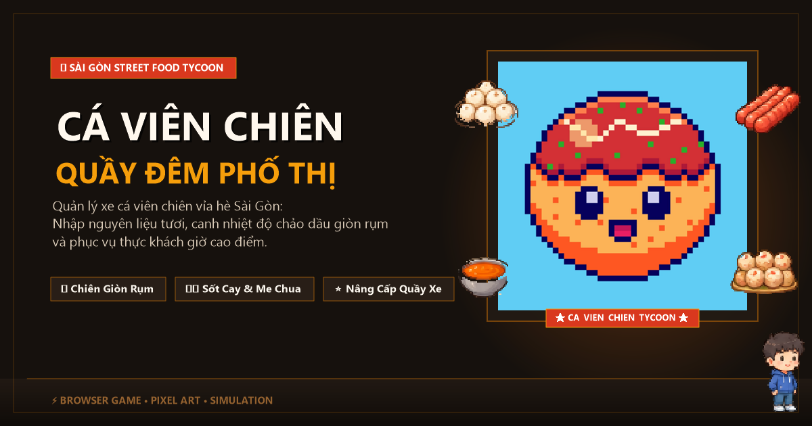

# Cá Viên Chiên Tycoon — Quầy Đêm Sài Gòn



Game mô phỏng kinh doanh xe cá viên chiên vỉa hè đường phố Sài Gòn trên nền tảng web, phát triển bằng **Phaser 3** & **TypeScript** (Vite).

---

## 🎮 Điểm nổi bật (Features)

- **Quản lý nguyên liệu**: Nhập các xiên cá viên, tôm viên, bò viên, xúc xích, đậu hũ tươi mới mỗi ngày.
- **Canh nhiệt độ chuẩn**: Kiểm soát độ nóng chảo dầu để xiên chiên vàng giòn rụm mà không bị cháy.
- **Phục vụ khách hàng**: Đáp ứng đúng yêu cầu sốt (sốt me chua ngọt, tương ớt, tương đen) và đồ ăn kèm (dưa leo, đậu bắp, rau răm) cho từng đối tượng thực khách.
- **Nâng cấp quầy xe**: Mở rộng bếp chiên, nâng cấp bình gas, sắm thêm khay giữ ấm và mở rộng danh mục thực đơn.

---

## 🛠️ Công nghệ sử dụng (Tech Stack)

- **Engine**: Phaser 3 (`3.90.0`)
- **Ngôn ngữ**: TypeScript 5.6
- **Build tool**: Vite 5.4
- **Thiết kế**: Pixel Art phong cách ẩm thực đường phố Việt Nam kết hợp chuẩn UI Design System.

---

## 🚀 Khởi chạy dự án (Getting Started)

```bash
# Cài đặt thư viện
npm install

# Chạy môi trường phát triển (Local Dev)
npm run dev

# Đóng gói sản phẩm (Build Production)
npm run build
```
